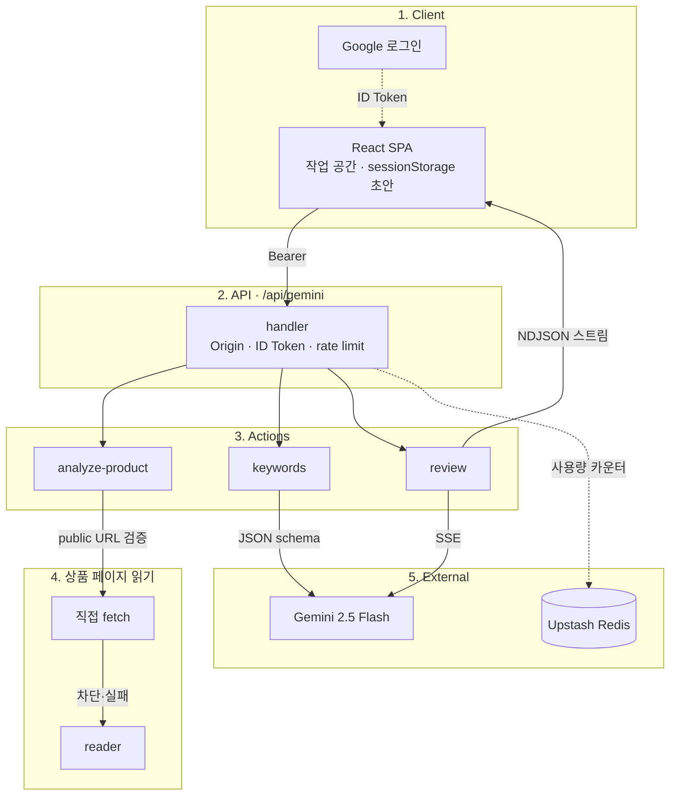

# Auto Review Generator — AI 리뷰 초안 생성 서비스

사진·상품 링크·별점·경험 메모를 받아 한국어 리뷰 초안을 스트리밍으로 만들어 주는 웹 서비스.
React SPA + Vercel 서버리스 API 하나(`/api/gemini`)로 구성하고, Gemini 2.5 Flash로 키워드와 리뷰를 생성.

**개인 프로젝트**

---

## Overview

- **Objective** : 사진·상품 링크 → 키워드 → 리뷰 초안 → 다듬기 흐름을 한 화면에서 처리
- **Method** : 상품 페이지 분석(직접 읽기 → reader 순 대체) + 분야·별점별 프롬프트 분기 + NDJSON 스트리밍
- **Tools** : React 19, Vite, Vercel Functions, Gemini 2.5 Flash, Upstash Redis

## Features

- 장소(음식점·카페·숙소 등)와 상품(뷰티·패션·전자기기 등) 분야별로 프롬프트 조건·금지 표현 분기
- 상품 URL에서 상품명·브랜드·가격·옵션 추출, 차단·실패 시 대체 경로로 읽고 끝내 실패하면 직접 입력으로 전환
- 사진 최대 3장 업로드·붙여넣기, 서버는 MIME·base64·시그니처·크기 재검증
- 키워드 선택·직접 추가·다시 추천, 분량·말투 선택 후 리뷰를 스트리밍으로 표시
- 새로 생성·다듬기·강조 단어 바꾸기 결과를 버전(v1, v2…)으로 최대 10개 보관
- 입력과 결과를 탭 단위(`sessionStorage`)로 저장해 새로고침 후에도 이어 쓰기
- Google ID Token 인증, Origin 제한, 사용자/IP별 rate limit·일일 사용량 제한, SSRF 방어

## Tech Stack

- **Frontend** : React 19, Vite, CSS Variables
- **Backend** : Node.js 24, Vercel Serverless Functions (ESM)
- **AI** : Google Gemini 2.5 Flash (키워드는 `responseSchema` JSON, 리뷰는 SSE 스트리밍)
- **Auth** : Google OAuth ID Token (`google-auth-library`)
- **Product Analysis** : HTML meta·JSON-LD·embedded JSON 파싱, reader(`r.jina.ai`)
- **Infra** : Vercel, Upstash Redis (선택)
- **Test** : `node:test`

---

## Architecture



---

## Getting Started

```bash
cp .env.example .env.local   # GEMINI_API_KEY, GOOGLE_CLIENT_ID, VITE_GOOGLE_CLIENT_ID, ALLOWED_ORIGINS
npm install

npm run dev          # 프론트엔드만 (http://localhost:5173)
npm run dev:vercel   # 서버리스 API 포함 (vercel env pull .env.local 후)
```

| 변수 | 용도 |
|---|---|
| `GEMINI_API_KEY` | 서버에서 Gemini 호출 |
| `GOOGLE_CLIENT_ID` / `VITE_GOOGLE_CLIENT_ID` | ID Token audience 검증 / 브라우저 로그인 |
| `ALLOWED_ORIGINS` | API 호출을 허용할 Origin (쉼표 구분) |
| `UPSTASH_REDIS_REST_URL` / `_TOKEN` | (선택) 인스턴스 간 공유 rate limit |

테스트 (API 키·Redis 불필요):

```bash
npm test && npm run lint && npm run build   # 91 tests
```

Vercel Production 빌드는 `scripts/verify-vercel-env.js`가 필수 환경 변수를 먼저 확인하고, 없으면 배포 전에 실패.

---

## Troubleshooting

| 문제 | 해결 | 드러나는 역량 |
|---|---|---|
| 쇼핑몰이 서버 요청을 403·봇 확인 페이지로 막아 상품 정보를 못 읽음 | 직접 fetch → reader 순으로 대체, 봇 확인 페이지는 상품 정보로 오인하지 않고 직접 입력 상태로 전환 | 외부 의존 실패를 단계적으로 흡수 |
| 사용자가 넣은 URL로 서버가 내부망에 요청할 수 있음 (SSRF), IPv4-mapped IPv6로 우회 가능 | fetch 전·redirect마다 public URL 재검증, 사설망·metadata host·인증정보 URL 차단, 렌더링 중 네트워크 요청도 검사 | 보안 빈틈 직접 찾아 막기 |
| 긴 리뷰가 토큰 한도에서 잘린 채 표시됨 | 분량별 출력 토큰 한도 분리, `MAX_TOKENS`면 서버가 스트림에 에러를 보내 버리고 다시 생성 유도 | 실패를 성공처럼 보이지 않게 하기 |
| "다른 키워드 추천"이 같은 키워드를 반복, 뷰티 상품에서 용기·패키지 키워드만 나옴 | 이전 키워드를 프롬프트에 넣고 같은 조합이면 재요청, 용기 중심 키워드는 걸러 내고 보완 지시로 재시도 | 모델 출력을 검증하고 재시도로 보정 |
| 화면에서 통과한 직접 입력 키워드가 서버 프롬프트에서 빠짐 | 키워드 문구 규칙(`isLikelyKeywordPhrase`)을 `shared/`로 옮겨 화면·서버가 같은 규칙 사용 | 규칙의 단일 출처 |
| 버전이 10개일 때 생성이 실패하면 가장 오래된 초안이 사라지고 다른 버전이 선택됨 | 생성 전 버전 목록·선택을 보관했다가 실패 시 그대로 복원 | 실패 경로의 상태 정합성 |
| 서버리스 인스턴스마다 rate limit이 따로 세어짐 | Upstash Redis가 있으면 공유 카운터, 없으면 인메모리로 동작, 저장소 오류 시 503 | 실행 환경 차이 반영 |

## Limitations

- Upstash 없이 배포하면 rate limit·사용량이 인스턴스별로 따로 계산됨 → Redis 필수화
- 이미지는 용량 때문에 초안에 저장하지 않아 새로고침 후 다시 올려야 함 → IndexedDB 저장
- 상품 분석은 사이트 구조에 의존, JS로 그리는 페이지는 읽지 못하고 직접 입력으로 전환 → 사이트별 어댑터, 결과 공유 캐시
- 키워드 응답은 JSON 스키마만 해석, 형식이 어긋나면 실패 처리 → 실패율 모니터링
- 단위 테스트만 있고 E2E 없음, Gemini 첫 chunk·전체 생성 시간 미측정 → Playwright E2E, 지연 시간 계측
