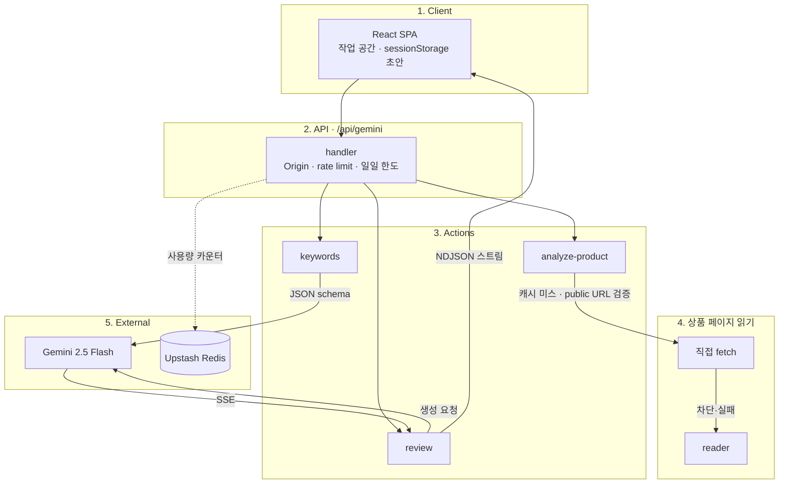

# Auto Review Generator — AI 리뷰 초안 생성 서비스

사진 또는 상품 링크에 별점·경험 메모를 더해 한국어 리뷰 초안을 만드는 개인 프로젝트입니다.
React SPA와 Vercel 서버리스 API 하나(`/api/gemini`)로 구성하며, Gemini 2.5 Flash로 키워드를 추천하고 리뷰를 스트리밍으로 생성합니다.

## 사용 흐름

1. 홈에서 새 리뷰를 시작하거나, 임시 초안을 이어서 작성합니다. 기존 초안이 있을 때 새 리뷰를 시작하면 초기화 전에 확인합니다.
2. 장소·상품을 고르고 사진 또는 상품 링크를 추가합니다. 사진·링크 입력 다음에 세부 분야·별점·경험 메모를 입력하며, 상품 분석 결과는 직접 수정하고 옵션을 선택할 수 있습니다.
3. 추천 키워드를 선택하거나 직접 추가하고, 분량·말투를 정해 리뷰를 생성합니다.
4. 초안을 직접 편집·복사하거나 AI로 다듬고, 이전 버전과 비교합니다.

**홈 → 리뷰 재료 → 키워드·문체 → 리뷰 결과**로 이어지는 모바일 앱 형태입니다. 작성 중에는 상단 뒤로가기·홈 버튼과 화면 하단에 고정된 주요 버튼으로 이동합니다. 키워드 추천과 리뷰 생성 시 다음 단계로 전환하며, 결과 화면의 버전 목록은 같은 리뷰의 생성·수정 기록입니다. 모든 화면 크기에서 한 번에 한 화면을 보여 주며, 데스크톱에서는 최대 480px 폭으로 표시합니다.

## Features

- 장소(음식점·카페·숙소 등)와 상품(뷰티·패션·전자기기 등) 분야별로 프롬프트 조건·금지 표현 분기
- 상품 URL의 HTML meta·JSON-LD·embedded JSON 등에서 상품 정보와 옵션 추출. 접근 차단·요청 실패 시 reader(`r.jina.ai`)로 대체하고, 정보가 부족하면 직접 입력으로 보완
- 상품 분석 결과는 서버 인스턴스 메모리에 10분간 최대 80개 캐시. 캐시 적중 시 상품 분석 일일 한도는 차감하지 않음
- 사진 최대 3장 업로드·드래그 앤 드롭·붙여넣기. 미리보기의 추가 버튼으로 기존 사진에 더하거나 사진을 다시 선택해 교체. 원본은 장당 15MiB 이하이며, 브라우저에서 긴 변 최대 448px의 JPEG로 변환한 뒤 전송
- 키워드 3~8개 추천, 선택·직접 추가·다시 추천. 이전과 같은 조합이나 뷰티 상품의 용기 중심 키워드는 검증 후 재시도
- 분량 4단계(최소 30·60·90·200자), 말투 4종(기본·친근·격식·반말) 선택 후 리뷰 스트리밍 표시
- 새로 생성·다듬기·강조 단어 바꾸기 결과를 버전(v1, v2…)으로 최대 10개 보관
- 새 초안에는 현재 별점·경험 메모를 반영하고, 이전 버전을 다듬을 때는 그 버전에 저장된 생성 근거와 문체를 사용
- 리뷰에 입력 근거(상품 정보·직접 경험·별점·키워드)에 없는 숫자·영문이 들어가면 표시하고 빼서 다듬기 (`shared/evidenceCheck.js`를 화면과 eval에서 공유)
- 리뷰에 빠진 키워드 표시·보완, 다듬기 요청 직접 입력, 원본 버전과 비교, 오늘 남은 생성 횟수 표시
- 입력·키워드·리뷰 버전을 탭 단위(`sessionStorage`)로 저장해 새로고침 후에도 이어 쓰기. 이미지 원본·변환 데이터는 저장하지 않음
- 생성 실패 시 이전 버전 목록과 선택 상태 복원. 서버에서 감지한 생성 실패는 일일 사용량 차감 취소를 시도하고, 리뷰 응답에 갱신된 남은 횟수를 전달
- Origin 제한, IP별 rate limit·일일 사용량 제한, SSRF 방어

## Tech Stack

- **Frontend** : React 19, Vite 8, CSS Variables
- **Backend** : Node.js 26.x (`package.json` 기준), Vercel Serverless Functions (ESM), Undici
- **AI** : Google Gemini 2.5 Flash (키워드는 `responseSchema` JSON, 리뷰는 Gemini SSE → 클라이언트 NDJSON 변환)
- **Product Analysis** : HTML meta·JSON-LD·embedded JSON 파싱, reader(`r.jina.ai`)
- **Infra** : Vercel, Upstash Redis
- **검증** : `node:test`, jsdom 기반 React DOM 통합 테스트, ESLint, Vite build, 리뷰 품질 평가 스크립트

로컬 실행 환경과 GitHub Actions는 `package.json`의 Node.js 26.x를 기준으로 맞춥니다.

## Architecture



## 프로젝트 구조

```text
src/
  App.jsx                              앱 헤더·작업 공간
  components/ReviewGenerator/
    ReviewGenerator.jsx                홈·단계별 이동·하단 고정 작업 버튼
    AppIcon.jsx                        앱 공통 SVG 아이콘
    layout/                            앱바·단계별 작업 버튼·초기화 대화상자
    hooks/useReviewWorkspace.js        입력·상품 분석·키워드 흐름 조합
    hooks/useDraftPersistence.js       자동 저장·페이지 이탈 시 저장
    hooks/useReviewGeneration.js       리뷰 생성·사용량·실패 복원
    hooks/useReviewClipboard.js        리뷰 복사·완료 및 실패 상태
    hooks/useReviewVersions.js         버전 추가·편집·실패 시 복원
    hooks/useUploadImages.js           사진 업로드·붙여넣기 상태
    sections/                          분야·입력·상품·키워드·결과 UI
      ReviewContent.jsx                리뷰 읽기·편집·강조 단어 수정
      ReviewRewritePanel.jsx           기본·직접 입력 다듬기
    services/geminiService.js           API 호출·NDJSON 스트림 처리
    utils/                             저장·생성·버전 전환·수정 지시문·키워드 공통 로직
  styles/                              앱 셸·홈·공통 컨트롤·입력·업로드·키워드·결과 스타일
api/gemini.js                          세 가지 action의 공통 진입점
server/
  review/                              Gemini 호출·프롬프트·키워드 검증·리뷰 스트리밍
  product/                             상품 HTML 파싱·reader·인메모리 캐시
  publicUrlGuard.js                    공개 URL·연결 시 DNS 주소 검증
  auth.js / rateLimit.js               Origin·클라이언트 IP·요청 및 일일 한도
shared/                               분야·분량·말투·키워드·근거 검사·스트림 공통 규칙
eval/                                 리뷰 평가 케이스·실행·채점
scripts/verify-vercel-env.js            Vercel 빌드 전 필수 환경 변수 확인
tests/dom/                            React 훅·화면·CSS 계약 통합 검증
tests/helpers/                        격리된 DOM 환경·초안 데이터
```

## Getting Started

Node.js 26.x와 npm이 필요합니다. API까지 로컬에서 실행하려면 Vercel CLI가 설치되어 있어야 합니다.

```bash
npm ci
cp .env.example .env.local
```

`.env.local`에 서버 환경 변수를 설정합니다. 이미 연결된 Vercel 프로젝트의 값은 `vercel env pull .env.local`로 가져올 수 있습니다.

| 변수 | 용도·적용 조건 |
|---|---|
| `GEMINI_API_KEY` | 키워드·리뷰 생성에 필요. 상품 링크 분석 자체는 Gemini를 호출하지 않음 |
| `ALLOWED_ORIGINS` | 운영 모드(`NODE_ENV=production`)에서 허용할 Origin을 쉼표로 구분. 예: `https://your-app.vercel.app,https://your-domain.com` |
| `UPSTASH_REDIS_REST_URL` | 인스턴스 간 공유 요청·일일 한도를 저장할 Redis REST URL |
| `UPSTASH_REDIS_REST_TOKEN` | Redis REST 인증 토큰. URL과 토큰이 모두 있어야 공유 저장소 사용 |

환경 변수는 서버에서만 사용합니다. `VITE_` 접두사를 붙이지 않습니다.

```bash
npm run dev          # 프론트엔드만 실행 (기본 http://localhost:5173)
npm run dev:vercel   # 프론트엔드 + /api/gemini 실행
```

Vite 단독 실행에는 API 프록시가 없으므로, 상품 분석·키워드·리뷰 생성까지 확인하려면 `dev:vercel`을 사용합니다. 로컬에서 Redis를 설정하지 않으면 한도는 인메모리로 계산합니다.

## API와 사용량 제한

클라이언트는 `POST /api/gemini`의 JSON 본문에 `action`을 지정합니다.

| action | 주요 입력 | 응답 |
|---|---|---|
| `analyze-product` | `productUrl` | 상품 정보·옵션·분석 상태 JSON |
| `keywords` | `images` 또는 `productContext`, 별점·분야, `previousKeywords` | `keywords` 배열을 포함한 JSON |
| `review` | `keywords`, 별점·분야·분량·말투·`productContext`, 선택적 기존 리뷰·수정 지시 | `application/x-ndjson` 스트림 |

리뷰 스트림은 `{ "text": "…" }` 조각을 보냅니다. 서버는 Gemini의 `STOP`과 최소 글자수를 모두 확인한 뒤 `{ "done": true, ... }`를 보내고, 클라이언트는 이 메시지를 받은 뒤 새 버전을 확정합니다. `{ "error": "…", ... }`를 받거나 완료 메시지 없이 연결이 끝나면 이전 버전 상태를 복원합니다.

| 제한 | 현재 설정 |
|---|---|
| IP별 요청 제한 | 60초 기준 20회. 인메모리는 sliding window, Redis는 이전·현재 창을 가중 합산 |
| IP별 일일 한도 | 키워드 20회, 리뷰 생성·다듬기 합산 20회, 상품 분석 60회 |
| 일일 한도 초기화 | 한국 시간(KST) 자정 |
| 요청 본문 | 최대 2MiB |
| 서버 이미지 검증 | 최대 3장, 장당 디코딩 후 1.5MiB 이하, JPEG·PNG·WebP의 MIME·base64·파일 시그니처 확인 |

리뷰의 남은 횟수와 초기화까지 남은 초는 `X-Review-Remaining`, `X-Review-Reset` 헤더로 전달합니다. 화면은 이를 `localStorage`에 저장합니다. 한도 초과는 429, 공유 한도 저장소 오류는 503으로 응답합니다.

## 검증과 품질 평가

단위·API·DOM 통합 테스트는 Gemini API 키·Redis 없이 실행할 수 있습니다. 현재 테스트는 147개이며, API 테스트 중 로컬 HTTP 서버를 여는 테스트가 있어 전체 실행에는 포트 바인딩을 허용하는 환경이 필요합니다.

```bash
npm test
npm run test:dom  # DOM 통합 테스트 22개만 실행
npm run lint
npm run build
```

GitHub Actions는 push·pull request마다 `npm ci` 후 `npm test`·lint·build를 실행하며, DOM 통합 테스트도 `npm test`에 자동으로 포함됩니다. DOM 테스트는 실제 화면 대신 jsdom에서 React를 마운트하고 API 응답을 모킹하므로 별도 브라우저·포트·외부 네트워크가 필요하지 않습니다.

검증 대상은 StrictMode의 자동 저장·초기화, 새로고침 복원, 상품 링크 변경 후 재분석, 사진 추가·교체와 변환 실패 복원, 사진 변환 중 새 리뷰 시작, 키워드 추천 중 사진 입력 잠금, 한글 조합 입력, 불완전한 스트림의 버전 복원, 실패 시 사용량 표시, 선택한 리뷰의 근거로 다듬기, 버전 전환 시 편집 상태와 다듬기 입력 유지, 초기·복원 화면 8가지의 표시와 주요 CSS 적용 결과입니다. 전역 DOM·저장소·API 모킹은 테스트마다 정리합니다.

`npm run preview`는 빌드한 프론트엔드 확인용이며 서버리스 API를 실행하지 않습니다.

리뷰 품질 평가는 `eval/cases.json`의 20개 케이스로 실제 Gemini를 호출합니다. API 키가 필요하며, 사용 중인 요금제의 호출 쿼터·비용이 적용됩니다. 앱 API의 IP별 사용량 제한은 거치지 않습니다.

```bash
npm run eval -- --label before --runs 2
npm run eval -- --label after --runs 2 --baseline eval/results/before.json
npm run eval -- --label beauty --only beauty --runs 1
```

근거에 없는 숫자·영문·케이스별 금지어, 키워드 반영률, 최소 분량 미달, `MAX_TOKENS` 잘림, 상투 문구, 첫 조각 지연·전체 생성 시간을 측정합니다. 결과는 `eval/results/<label>.json`에 저장하고 Markdown 표를 콘솔에 출력합니다. `--only`는 케이스 ID의 부분 문자열로 대상을 고릅니다.

## 배포와 요청 보호

- `vercel.json`은 Vite 빌드 결과 `dist/`를 배포하고 `/api/gemini`의 최대 실행 시간을 60초로 설정합니다.
- `npm run build`의 prebuild 단계에서 `scripts/verify-vercel-env.js`를 실행합니다. `VERCEL=1`이면 위 환경 변수 4개를 모두 검사하므로 Production뿐 아니라 해당 조건의 Preview 빌드도 누락 시 실패합니다.
- 로그인 기능은 없습니다. 운영 모드의 Origin 허용 목록과 IP별 요청·일일 한도로 접근과 사용량을 제한합니다.
- 상품 URL과 각 리다이렉트를 검증하고, Undici 연결 시 DNS가 반환한 IP를 검사해 사설·예약 대역과 metadata 주소 등을 차단합니다. 인증 정보가 포함된 URL도 허용하지 않습니다.
- 상품 분석은 전체 45초, 키워드 생성은 전체 50초 제한을 두며, 상품 응답 본문은 최대 512KiB까지만 읽습니다.
- 배포 응답에 CSP, HSTS, 프레임 삽입 금지 등 보안 헤더를 적용합니다.

## Troubleshooting

| 증상 | 현재 처리·확인할 사항 |
|---|---|
| Vite 화면은 뜨지만 API 요청이 실패함 | `npm run dev:vercel`로 실행하고 서버 환경 변수를 확인 |
| Vercel 빌드에서 환경 변수 누락 오류가 남 | Gemini 키·허용 Origin·Redis URL·토큰을 해당 배포 환경에 모두 설정 |
| 쇼핑몰이 403·봇 확인 페이지를 반환함 | 직접 fetch → reader로 대체. reader 결과도 확인·보완 대상으로 표시하며, 정보가 부족하면 상품명 또는 특징을 입력 |
| 긴 리뷰가 중간에 잘리거나 너무 짧게 생성됨 | 서버가 잘림·분량 미달을 오류로 보내고 실패 버전을 복원하므로 다시 생성 |
| 다른 키워드 추천이 같은 조합을 반복함 | 이전 조합을 제외하도록 지시하고 결과를 검증. 반복·용기 중심 결과 보정은 최대 3회 시도하며 계속 실패하면 오류 표시 |
| 입력을 바꿨는데 키워드가 그대로임 | 기존 키워드를 유지하고 입력 변경 안내를 표시. 뒤로가기로 재료 입력 단계에서 키워드를 다시 추천받거나 기존 키워드로 계속 진행. 리뷰 생성 시 별점·경험 메모는 현재 입력값 사용 |
| 429 또는 503이 반환됨 | 429는 앱 요청·일일 한도 또는 Gemini 쿼터 초과 여부를 확인. 공유 한도 저장소 오류에 따른 503은 Upstash 설정·접근 상태를 확인 |

## Limitations

- 이미지는 초안에 저장하지 않아 새로고침 후 새 사진 분석·키워드 추천에는 다시 업로드해야 합니다. 탭을 닫은 뒤에도 초안을 보존하는 영구 저장·계정 동기화는 없습니다.
- 상품 분석은 사이트 구조와 reader 응답에 의존합니다. 앱 서버는 브라우저로 페이지 JavaScript를 실행하지 않으며, HTML·embedded JSON·reader에서 정보를 얻지 못하면 직접 보완해야 합니다.
- 상품 분석 캐시는 인스턴스별 메모리이므로 인스턴스 간 공유되지 않고 재시작 시 사라집니다. Redis는 현재 요청·일일 한도에 사용합니다.
- 키워드는 잘린 JSON에서 완성된 문구를 복구할 수 있지만, 유효한 키워드가 최소 3개보다 적거나 응답이 차단되면 실패합니다.
- 화면의 근거 검사는 숫자·영문 토큰에 한정하고, eval은 여기에 케이스별 금지어를 추가합니다. 근거 없는 한국어 서술 전체를 판별하거나 사실성을 보장하지는 못합니다.
- 현재 자동 검증은 단위·API·jsdom DOM 통합 테스트입니다. 실제 브라우저의 모바일 레이아웃·키보드·대화상자 포커스를 확인하는 E2E 테스트는 없습니다.

개선 후보는 이미지의 IndexedDB 저장, 사이트별 상품 분석 어댑터·공유 캐시, Playwright E2E, LLM 기반 리뷰 평가입니다.
